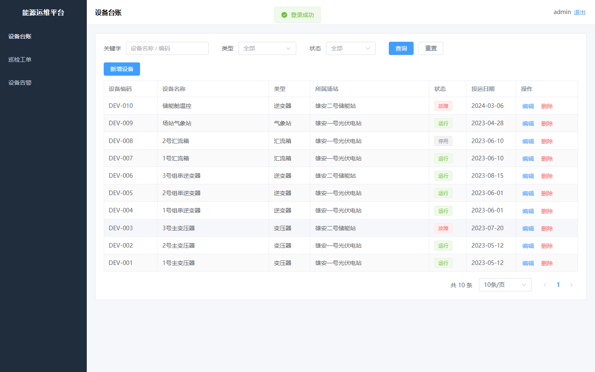
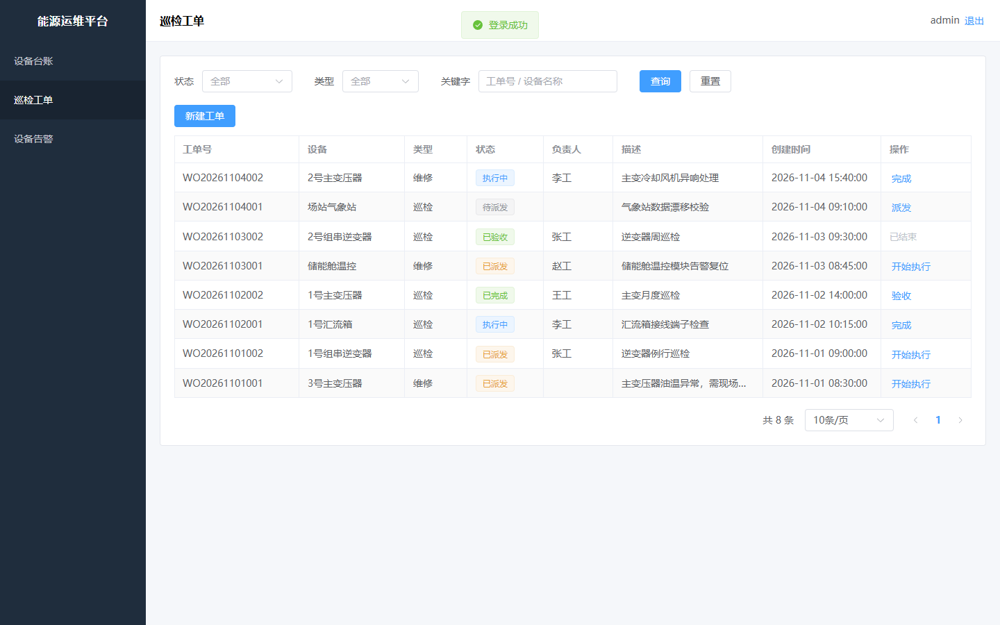
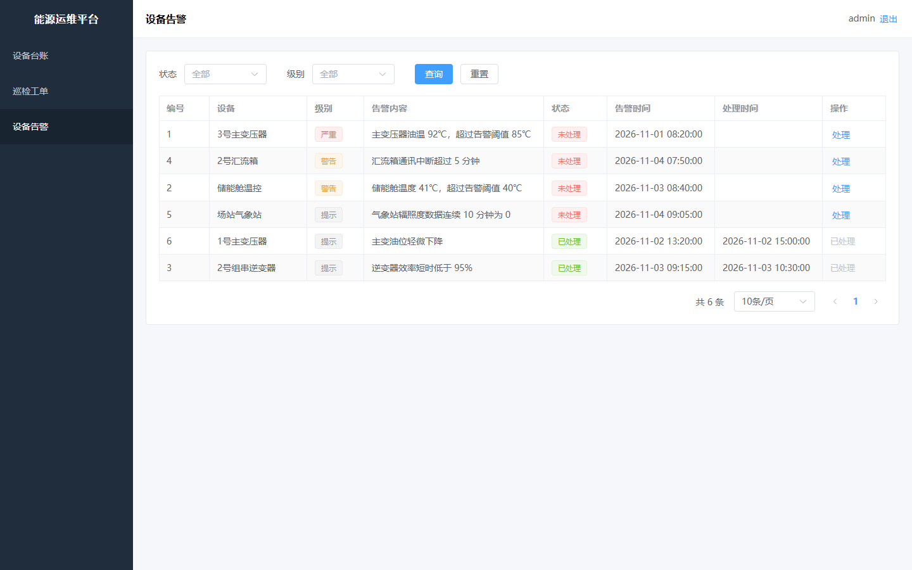

# 能源场站设备运维管理平台

面向能源场站的设备台账、巡检工单与告警管理：设备一物一码、巡检计划自动派发、告警集中处理，替代 Excel 台账与纸质巡检单。

> 技术栈：**Java 21 / Spring Boot 3.5 / MyBatis-Plus / MySQL 8 / Redis 7 / SpringDoc(Swagger) / Vue 3 + Element Plus / Vite**

---

## 一、功能

| 模块 | 能力 |
|---|---|
| 登录认证 | 账号密码登录，令牌存 Redis（2 小时过期），拦截器统一校验 |
| 设备台账 | 分页、按名称/编码搜索、按类型和状态过滤、增删改查 |
| 设备类型 | 字典数据，Redis 缓存（30 分钟 + 随机抖动），写操作后删缓存 |
| 巡检计划 | 按设备查询巡检周期与下次巡检时间 |
| 巡检工单 | 新建工单、状态流转（待派发 → 已派发 → 执行中 → 已完成 → 已验收），状态更新与流转日志同事务 |
| 设备告警 | 按状态/级别筛选，处理告警后记录处理时间 |

## 界面

| 设备台账 | 巡检工单 | 设备告警 |
|---|---|---|
|  |  |  |

---

## 二、快速启动

### 1. 启动 MySQL 与 Redis

```bash
docker compose up -d
```

> 本机若 3306 已被占用，compose 里映射的是 **3307:3306**，后端配置也是 3307。

### 2. 初始化数据库

```bash
docker exec -i energy-mysql mysql -uroot -p123456 --default-character-set=utf8mb4 < db/init.sql
```

脚本可重复执行：建表用 `IF NOT EXISTS`，种子数据每次清空重灌。

### 3. 启动后端

需要 **JDK 21**（Spring Boot 3.5 支持 17~24，不建议用更高版本）。

```bash
cd backend
./mvnw spring-boot:run          # Windows: mvnw.cmd spring-boot:run
```

- 接口地址：<http://localhost:8080>
- Swagger：<http://localhost:8080/swagger-ui/index.html>

### 4. 启动前端

```bash
cd frontend
npm install
npm run dev
```

- 页面地址：<http://localhost:5173>
- 演示账号：**admin / 123456**

---

## 三、目录结构

```
energy-ops-platform/
├── backend/
│   ├── src/main/java/com/energy/ops/
│   │   ├── auth/         登录令牌、拦截器、登录接口
│   │   ├── common/       统一返回 Result、分页 PageResult、业务异常、全局异常处理、字典文案
│   │   ├── config/       MyBatis-Plus 分页插件、Swagger、拦截器注册与 CORS
│   │   ├── controller/   设备、类型、工单、告警、巡检计划
│   │   ├── dto/          入参对象（带校验注解）
│   │   ├── entity/       数据库实体
│   │   ├── mapper/       MyBatis Mapper 接口
│   │   ├── service/      业务逻辑（缓存、事务、状态机）
│   │   └── vo/           出参对象
│   └── src/main/resources/
│       ├── application.yml
│       └── mapper/       MyBatis XML（LEFT JOIN、动态 SQL）
├── frontend/
│   └── src/
│       ├── api/          axios 封装与接口定义
│       ├── router/       路由与登录守卫
│       └── views/        登录、布局、设备台账、工单看板、告警列表
├── db/init.sql           建表 + 种子数据
└── docker-compose.yml
```

---

## 四、接口清单

| 方法 | 路径 | 说明 |
|---|---|---|
| POST | `/api/auth/login` | 登录，返回令牌 |
| POST | `/api/auth/logout` | 退出登录 |
| GET | `/api/devices` | 分页查询设备（page/size/keyword/typeId/status） |
| GET | `/api/devices/{id}` | 设备详情 |
| POST | `/api/devices` | 新增设备 |
| PUT | `/api/devices/{id}` | 修改设备 |
| DELETE | `/api/devices/{id}` | 删除设备 |
| GET | `/api/device-types` | 设备类型列表（走缓存） |
| POST/PUT/DELETE | `/api/device-types` | 类型维护（写后删缓存） |
| GET | `/api/work-orders` | 分页查询工单（status/type/keyword） |
| POST | `/api/work-orders` | 新建工单 |
| PUT | `/api/work-orders/{id}/status` | 工单状态流转 |
| GET | `/api/alarms` | 分页查询告警（status/level） |
| PUT | `/api/alarms/{id}/handle` | 处理告警 |
| GET | `/api/inspection-plans` | 分页查询巡检计划（deviceId） |

统一返回结构：

```json
{ "code": 200, "msg": "success", "data": {}, "timestamp": 1762300000000 }
```

---

## 五、表结构

| 表 | 说明 | 关键字段 |
|---|---|---|
| `device_type` | 设备类型字典 | `code`（唯一）、`name` |
| `device` | 设备台账 | `code`（唯一，一物一码）、`type_id`、`station`、`status` |
| `inspection_plan` | 巡检计划 | `device_id`、`cycle_days`、`next_time` |
| `work_order` | 巡检/维修工单 | `code`、`device_id`、`type`、`status` |
| `work_order_log` | 工单状态流转日志 | `order_id`、`from_status`、`to_status`、`operator` |
| `alarm` | 设备告警 | `device_id`、`level`、`status`、`handle_time` |

---

## 六、面试可讲的技术点

### 1. 统一返回 + 全局异常

所有接口返回 `{code, msg, data}`。`@RestControllerAdvice` 分别处理业务异常、参数校验异常和兜底异常；异常堆栈只打服务端日志，不返回前端。

### 2. 参数校验

DTO 上使用 `@NotBlank`、`@NotNull`、`@Size`，Controller 参数加 `@Valid`，校验失败由全局异常处理器统一返回 400。

### 3. DTO / VO 分离

`Device` 是数据库实体，`DeviceDTO` 只接收前端允许传的字段，`DeviceVO` 只返回前端需要的字段（附带 `typeName`、`statusText`），避免实体直接暴露。

### 4. MyBatis 动态 SQL 与 JOIN

设备、工单、告警的分页查询都写在 XML 里：`<where>` + `<if>` 组合条件，`LEFT JOIN` 拿到类型名、设备名，避免在 Java 里循环查库。

### 5. 事务

工单状态流转时，「更新工单状态」和「写流转日志」在同一个 `@Transactional(rollbackFor = Exception.class)` 方法里；状态不合法会抛业务异常，两条 SQL 一起回滚。

### 6. Redis 缓存（Cache Aside）

设备类型是典型的读多写少数据：读时先查 Redis，未命中再查库并回填，过期时间 30 分钟加 0~300 秒随机值；写操作**先更新 MySQL，再删除缓存**，下次读时自然重建。

### 7. 登录令牌

登录成功后生成 UUID 令牌，存 Redis 并设置 2 小时过期；拦截器从 `Authorization: Bearer <token>` 取令牌校验。服务端无会话状态，多实例部署时共享 Redis 即可。

### 8. 前后端联调

前端 axios 封装请求拦截器（统一带令牌）和响应拦截器（统一解包、统一错误提示、401 跳登录）；开发期用 Vite proxy 把 `/api` 转发到 8080，避免跨域。

---

## 七、运行验证记录

本项目已在本机完整跑通，验证内容：

| 项目 | 结果 |
|---|---|
| 未带令牌访问 `/api/devices` | 返回 **401** |
| 登录 admin / 123456 | 返回 32 位令牌，写入 Redis（TTL 2h） |
| `GET /api/devices` | total = 10，类型名、状态文案正常 |
| `GET /api/device-types` | 返回 4 类；Redis 出现 `dict:device-type`，TTL ≈ 30 分钟 + 随机值 |
| `GET /api/work-orders` | total = 8 |
| `GET /api/alarms` | total = 6 |
| 合法流转（待派发 → 已派发） | code = 200 |
| 非法流转（已派发 → 已验收） | code = 400，提示「不允许从「已派发」流转到「已验收」」 |
| 前端登录后三页 | 设备 10 行、工单 8 行、告警 6 行 |
| `npm run build` | 构建成功（1680 modules） |

---

## 八、已知限制

- 登录用户是演示用的硬编码账号，没有接用户表与权限模型；
- 巡检计划目前只提供查询，没有到点自动生成工单的定时任务；
- 未写单元测试，验证方式为接口自测 + 页面操作；
- 演示数据为种子脚本生成，非真实生产数据；
- Element Plus 目前是全量引入，打包后 JS 约 1.1 MB，可改为按需引入（`unplugin-vue-components`）进一步优化。
