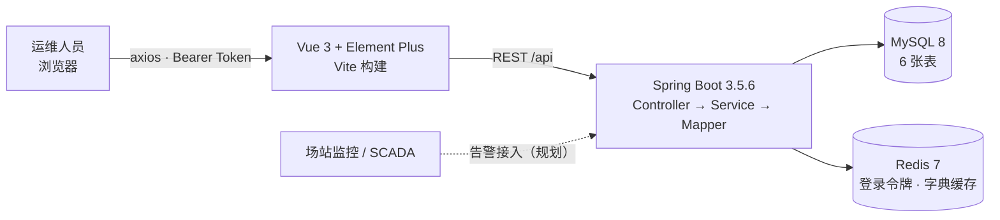

# 能源场站设备运维管理平台

面向光伏、储能等能源场站的设备运维系统，覆盖 **设备台账、巡检计划、工单流转、告警处置** 四个环节，替代「Excel 台账 + 纸质巡检单 + 电话派工」的传统作业方式。


---

## 一、业务背景

一个中型光伏场站的设备量在几百台量级（主变、逆变器、汇流箱、气象站、储能温控等），分布在若干个场站，日常运维长期存在四个问题：

| 问题 | 现场表现 |
|---|---|
| 台账分散 | 设备信息散落在多个 Excel，型号、投运日期、所属场站对不齐，查一台设备要翻几份表 |
| 巡检靠人工盯 | 巡检周期写在纸质计划表上，到期提醒靠班组长自己算，漏巡难以发现 |
| 工单无留痕 | 报修靠电话和群消息，谁派的、什么时候完成的、验收没验收，事后无法追溯 |
| 告警不集中 | 各家设备的监控数据分散在不同系统，值班人员要在多个界面之间来回切换 |

本平台把上述环节收敛到一个系统：**设备一物一码建档 → 按周期维护巡检计划 → 巡检/维修走工单流转 → 告警集中处理并留痕**，所有状态变更落库可追溯。

## 二、功能模块

| 模块 | 能力 |
|---|---|
| 登录认证 | 账号密码登录，令牌存 Redis（2 小时过期），拦截器统一校验 |
| 设备台账 | 分页、按名称/编码搜索、按类型和状态过滤、增删改查；设备编码唯一，一物一码 |
| 设备类型 | 字典数据，Redis 缓存（30 分钟 + 随机抖动），写操作后删缓存 |
| 巡检计划 | 按设备维护巡检周期与下次巡检时间，支持启用/停用 |
| 巡检工单 | 新建工单、五级状态流转（待派发 → 已派发 → 执行中 → 已完成 → 已验收），状态变更与流转日志同事务 |
| 设备告警 | 按状态/级别筛选，告警内容带阈值信息，处理后记录处理时间 |

### 界面

| 设备台账 | 巡检工单 | 设备告警 |
|---|---|---|
|  |  |  |

## 三、技术架构



**后端分层**：`Controller` 只做参数校验与响应封装，`Service` 承担事务、缓存与状态机，`Mapper` 负责 SQL（XML 中写 JOIN 与动态条件）。实体 `Entity` 与出入参 `DTO / VO` 分离，数据库结构不直接暴露给前端。

**技术选型**：

- **Spring Boot 3.5 + JDK 21**：单进程即可部署在场站内网的边缘服务器上，无需额外中间件；
- **MyBatis-Plus**：台账类查询以多条件分页为主，XML 手写 SQL 比 ORM 更直观，也便于后续加索引；
- **Redis**：只承担两类数据——登录令牌与设备类型字典，不做过早的缓存分层；
- **Vue 3 + Element Plus**：后台管理界面以表格、表单、弹窗为主，组件库能覆盖绝大部分交互。

## 四、关键设计

### 1. 统一返回结构 + 全局异常处理

所有接口固定返回 `{code, msg, data, timestamp}`，HTTP 状态码一律 200，业务结果看 `code`。前端响应拦截器只判断一次 `code` 即可，不用每个页面各写一套解析逻辑。

`@RestControllerAdvice` 分三类处理：业务异常（`BusinessException`，返回具体提示）、参数校验异常（`MethodArgumentNotValidException`，返回第一个字段错误）、兜底异常（返回统一文案）。异常堆栈只写服务端日志，不返回前端。

### 2. 参数校验前置

DTO 上使用 `@NotBlank / @NotNull / @Size`，Controller 参数加 `@Valid`，非法请求在进入业务层之前就被拦下，Service 内部只处理业务规则冲突。

### 3. DTO / VO 分离

`Device` 是数据库实体；`DeviceDTO` 只接收前端允许提交的字段，避免越权改字段；`DeviceVO` 只返回前端需要的字段，并附带 `typeName`、`statusText` 这类字典翻译结果，前端不再维护状态码对照表。

### 4. 列表查询放在 SQL 里

设备、工单、告警的分页查询都写在 Mapper XML 中：`<where> + <if>` 组合动态条件，`LEFT JOIN` 直接拿到类型名、设备名。把关联查询交给数据库，避免在 Java 里循环查库造成 N+1。

### 5. 工单状态机与事务

工单状态流转限定为 `0 待派发 → 1 已派发 → 2 执行中 → 3 已完成 → 4 已验收`，在 Service 内校验合法性，非法流转抛业务异常并给出明确提示。

「更新工单状态」与「写流转日志」在同一个 `@Transactional(rollbackFor = Exception.class)` 方法内，任一失败整体回滚，保证日志与状态永远一致。

### 6. Redis 缓存：Cache Aside

设备类型是典型的读多写少数据。读时先查 Redis，未命中查库并回填，过期时间 30 分钟叠加 0~300 秒随机值，避免批量键同时失效造成缓存雪崩；写操作**先更新 MySQL，再删除缓存**，下次读时自然重建。

### 7. 无状态登录

登录成功生成 UUID 令牌写入 Redis 并设置 2 小时过期；拦截器从 `Authorization: Bearer <token>` 解析并续期校验。服务端不保存会话，多实例部署时共享同一个 Redis 即可水平扩展。

### 8. 前后端联调约定

前端统一封装 axios：请求拦截器自动带令牌，响应拦截器统一解包 `data`、统一弹出错误提示、401 直接跳登录。开发期通过 Vite proxy 将 `/api` 转发到 `8080`，前后端各自独立启动，不依赖跨域配置。

## 五、快速开始

### 1. 启动 MySQL 与 Redis

```bash
docker compose up -d
```

> 本机若 3306 已被占用，compose 中映射的是 **3307:3306**，后端配置同样使用 3307。

### 2. 初始化数据库

```bash
docker exec -i energy-mysql mysql -uroot -p123456 --default-character-set=utf8mb4 < db/init.sql
```

脚本可重复执行：建表使用 `IF NOT EXISTS`，种子数据每次清空重灌。

### 3. 启动后端

需要 **JDK 21**（Spring Boot 3.5 支持 17~24，不建议使用更高版本）。

```bash
cd backend
./mvnw spring-boot:run          # Windows: mvnw.cmd spring-boot:run
```

- 接口地址：<http://localhost:8080>
- 接口文档：<http://localhost:8080/swagger-ui/index.html>

### 4. 启动前端

```bash
cd frontend
npm install
npm run dev
```

- 页面地址：<http://localhost:5173>
- 演示账号：**admin / 123456**

## 六、接口清单

| 方法 | 路径 | 说明 |
|---|---|---|
| POST | `/api/auth/login` | 登录，返回令牌 |
| POST | `/api/auth/logout` | 退出登录 |
| GET | `/api/devices` | 分页查询设备（page/size/keyword/typeId/status） |
| GET | `/api/devices/{id}` | 设备详情 |
| POST | `/api/devices` | 新增设备 |
| PUT | `/api/devices/{id}` | 修改设备 |
| DELETE | `/api/devices/{id}` | 删除设备 |
| GET | `/api/device-types` | 设备类型列表（走缓存） |
| POST/PUT/DELETE | `/api/device-types` | 类型维护（写后删缓存） |
| GET | `/api/work-orders` | 分页查询工单（status/type/keyword） |
| POST | `/api/work-orders` | 新建工单 |
| PUT | `/api/work-orders/{id}/status` | 工单状态流转 |
| GET | `/api/alarms` | 分页查询告警（status/level） |
| PUT | `/api/alarms/{id}/handle` | 处理告警 |
| GET | `/api/inspection-plans` | 分页查询巡检计划（deviceId） |

统一返回结构：

```json
{ "code": 200, "msg": "success", "data": {}, "timestamp": 1762300000000 }
```

## 七、数据模型

| 表 | 说明 | 关键字段 |
|---|---|---|
| `device_type` | 设备类型字典 | `code`（唯一）、`name` |
| `device` | 设备台账 | `code`（唯一，一物一码）、`type_id`、`station`、`status` |
| `inspection_plan` | 巡检计划 | `device_id`、`cycle_days`、`next_time`、`status` |
| `work_order` | 巡检/维修工单 | `code`（工单号）、`device_id`、`type`、`status`、`assignee` |
| `work_order_log` | 工单状态流转日志 | `order_id`、`from_status`、`to_status`、`operator` |
| `alarm` | 设备告警 | `device_id`、`level`、`status`、`handle_time` |

设备状态 `0 停用 / 1 运行 / 2 故障`，告警级别 `1 提示 / 2 警告 / 3 严重`，工单状态 `0~4` 五级；`station`、`type_id`、`status` 均建索引，覆盖列表页的过滤条件。

## 八、目录结构

```
energy-ops-platform/
├── backend/
│   ├── src/main/java/com/energy/ops/
│   │   ├── auth/         登录令牌、拦截器、登录接口
│   │   ├── common/       统一返回 Result、分页 PageResult、业务异常、全局异常处理、字典文案
│   │   ├── config/       MyBatis-Plus 分页插件、Swagger、拦截器注册与 CORS
│   │   ├── controller/   设备、类型、工单、告警、巡检计划
│   │   ├── dto/          入参对象（带校验注解）
│   │   ├── entity/       数据库实体
│   │   ├── mapper/       MyBatis Mapper 接口
│   │   ├── service/      业务逻辑（缓存、事务、状态机）
│   │   └── vo/           出参对象
│   └── src/main/resources/
│       ├── application.yml
│       └── mapper/       MyBatis XML（LEFT JOIN、动态 SQL）
├── frontend/
│   └── src/
│       ├── api/          axios 封装与接口定义
│       ├── router/       路由与登录守卫
│       └── views/        登录、布局、设备台账、工单看板、告警列表
├── db/init.sql           建表 + 种子数据
└── docker-compose.yml
```

## 九、验证记录

本地起 MySQL / Redis / 后端 / 前端完整跑通，逐项验证结果：

| 场景 | 结果 |
|---|---|
| 未带令牌访问 `/api/devices` | 返回 **401** |
| 登录 admin / 123456 | 返回 32 位令牌，写入 Redis（TTL 2h） |
| `GET /api/devices` | 分页正常，类型名、状态文案已翻译 |
| `GET /api/device-types` | 返回 4 类；Redis 出现 `dict:device-type`，TTL ≈ 30 分钟 + 随机值 |
| 合法流转（待派发 → 已派发） | `code = 200` |
| 非法流转（已派发 → 已验收） | `code = 400`，提示「不允许从「已派发」流转到「已验收」」 |
| 前端登录后三个页面 | 列表渲染、筛选、分页均可正常操作 |
| `npm run build` | 构建成功 |

## 十、后续规划

- **权限模型**：目前是演示账号，后续接入用户表与角色权限（场站运维 / 班组长 / 管理员）；
- **巡检自动派单**：巡检计划目前只提供查询，下一步加定时任务，到期自动生成工单；
- **告警接入**：打通场站监控/SCADA 的告警推送，替换当前的手工录入；
- **测试**：补充 Service 层单元测试与接口集成测试，替换当前的接口自测；
- **前端体积**：Element Plus 目前全量引入（构建后 JS 约 1.1 MB），可改为 `unplugin-vue-components` 按需引入。
